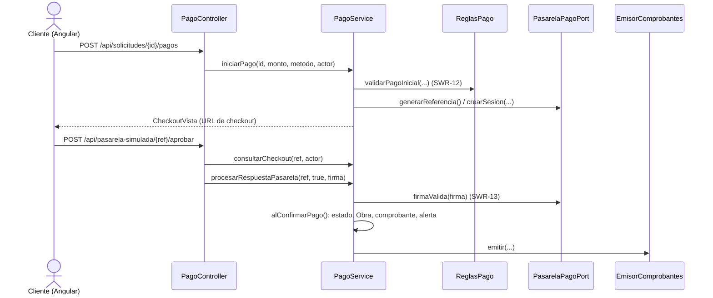

# Diagnóstico técnico y refactorización: F-05 Registrar pago de abono o anticipo

> Ingeniería de Software II · Taller de refactorización y cierre de arquitectura

---

## 1. Contexto

| Campo | Valor |
|---|---|
| Equipo | _Jhonatan David Vivas Arango, Valery Andrea Ortiz Mesa_ |
| Repositorio | https://github.com/DaveArango/Handgelus |
| Proyecto | Handgelus: atelier de tatuaje de autor y arte por comisión |
| Tecnología | Java 21 · Spring Boot 3.5 · Spring Security (JWT) · Spring Data JPA · Oracle · Angular 19 |
| Arquitectura | Hexagonal (puertos y adaptadores): `domain` → `application` (`port.in`, `port.out`, `service`) → `infrastructure` (`adapter.in`, `adapter.out`, `config`) |
| Funcionalidad | **F-05 · Registrar pago de abono o anticipo** |
| Requisitos | RF-08, RF-09, RF-14, SWR-12 (mínimo 30 % abono tatuaje / 50 % anticipo comisión), SWR-13 (confirmación por webhook firmado), SWR-14 (reversión a las 48 h), RN-01 (sin abono no hay cita), RN-10 (la comisión inicia producción con el anticipo) |

**Por qué F-05:** es una transacción de negocio completa que involucra varias entidades:
`Pago`, `Solicitud`, `Cotizacion`, `Obra`, `Comprobante` y `Notificacion`. Además integra un
sistema externo (la pasarela) y una tarea programada (la expiración a 48 h).

---

## 2. Arquitectura real de la funcionalidad

### 2.1 Componentes que participan

| Capa | Componente | Ruta (`backend/src/main/java/com/handgelus/…`) | Responsabilidad |
|---|---|---|---|
| Adaptador de entrada | `PagoController` | `infrastructure/adapter/in/web/PagoController.java` | Endpoints `/api/solicitudes/{id}/pagos`, `/pagos/manual`, `/pagos`, `/pagos/checkout/{ref}`, `/pagos/webhook` y `/pasarela-simulada/{ref}/{resultado}` |
| Adaptador de entrada | `TareasProgramadas` | `infrastructure/adapter/in/programador/TareasProgramadas.java` | Invoca `expirarPagosVencidos()` (SWR-14) |
| Puerto de entrada | `PagoUseCase` | `application/port/in/PagoUseCase.java` | Contrato del caso de uso F-05 (6 operaciones) |
| Servicio de aplicación | `PagoService` | `application/service/PagoService.java` | Orquesta el pago: valida, crea `Pago`, cambia estado de `Solicitud`, crea `Obra`, emite comprobante y notifica |
| Soporte de aplicación | `EmisorComprobantes`, `Notificador`, `EnsambladorDetalle` | `application/service/soporte/` | Comprobante con código consecutivo, correo y alerta, lectura agregada |
| Dominio | `ReglasPago`, `Pago`, `Solicitud`, `EstadoSolicitud`, `Obra` | `domain/service/`, `domain/model/` | Mínimos 30 %/50 %, saldo, transiciones de estado e invariantes |
| Puertos de salida | `PasarelaPagoPort`, `PagoRepositoryPort`, `SolicitudRepositoryPort`, `ObraRepositoryPort`, `ComprobanteRepositoryPort`… | `application/port/out/` | Abstracciones hacia pasarela y persistencia |
| Adaptadores de salida | `PasarelaPagoSimuladaAdapter`, `PagoPersistenceAdapter`, `PagoEntity`… | `infrastructure/adapter/out/…` | Pasarela simulada, JPA y Oracle |
| Configuración | `BeanConfig`, `SecurityConfig` | `infrastructure/config/…` | Composition root, transacción por AOP y reglas de acceso |
| Pruebas | `FlujoNegocioTest` | `backend/src/test/java/com/handgelus/application/FlujoNegocioTest.java` | Una única prueba con adaptadores en memoria: recorre F-01 a F-08 (61 verificaciones) |

### 2.2 Flujo (pago en línea)



### 2.3 Dependencias observadas

- La regla hexagonal se cumple en `domain` y `application`: son Java puro y dependen solo de puertos.
- **Excepción detectada:** `PagoController`, un adaptador de entrada, y `DatosIniciales`, de la
  configuración, dependen de la clase concreta `PasarelaPagoSimuladaAdapter`, que es un adaptador
  de salida (ver H-01).
- Cada método público de `application.service..*` corre en una transacción.
  `BeanConfig.transaccionesCasosDeUso`, líneas 86-98, la aplica con `rollback` ante cualquier `Exception`.

---

## 3. Hallazgos

> Las líneas citadas corresponden al código antes de la intervención. En cada hallazgo se distingue
> el **hecho** (verificable en el código) de la **hipótesis** (consecuencia que aún no se ha reproducido).

### H-01 · Riesgo arquitectónico: el controlador web depende de un adaptador de salida concreto

| Campo | Detalle |
|---|---|
| Ubicación | `infrastructure/adapter/in/web/PagoController.java`: import (l. 11), campo `pasarelaSimulada` (l. 34), constructor (l. 36-39), método `pasarelaSimulada` (l. 85-90) · `infrastructure/config/DatosIniciales.java`: import (l. 27), campo `pasarela` (l. 59), constructor (l. 64), llamada `pasarela.firmaConfigurada()` (l. 114) |
| Evidencia | `private final PasarelaPagoSimuladaAdapter pasarelaSimulada;` (l. 34) · `pasarelaSimulada.firmaConfigurada()` (l. 89). `firmaConfigurada()` es un método público que no pertenece al puerto: `PasarelaPagoSimuladaAdapter.java` l. 55-57; `PasarelaPagoPort.java` solo declara `generarReferencia`, `crearSesion` y `firmaValida`. El mismo acoplamiento aparece en `DatosIniciales` (carga de datos de demostración), detectado al compilar tras el cambio |
| Observación | **Hecho:** un adaptador de entrada conoce la clase concreta de un adaptador de salida y usa un método fuera del puerto. Así se salta la inversión de dependencias que el resto del proyecto respeta. **Hecho:** la documentación promete lo contrario. `README.md` l. 138-140 dice "Para MercadoPago/PayU basta otra implementación de `PasarelaPagoPort`"; la Javadoc del adaptador (l. 18-19) dice lo mismo. |
| Criterio | DIP (SOLID) y regla de dependencias de la arquitectura hexagonal (in → port.in, nunca in → out). Además, la implementación no coincide con la arquitectura documentada. |
| Impacto y riesgo | Si se registra otra implementación de `PasarelaPagoPort` y se retira la simulada, Spring no puede construir `PagoController` porque falta un bean de tipo `PasarelaPagoSimuladaAdapter`. Con eso cae **todo** F-05, no solo la pantalla simulada. **Hipótesis (seguridad):** el endpoint simulado no se puede desactivar; `SecurityConfig.java` l. 68 solo exige `authenticated()`. Si conviviera con una pasarela real, un cliente autenticado podría aprobar su propio pago, porque el endpoint inyecta la firma válida. |
| Acción propuesta | Mover el endpoint simulado a un adaptador de entrada propio (`PasarelaSimuladaController`) que dependa solo de `PagoUseCase` y de la configuración, activable por propiedad. Eliminar `firmaConfigurada()` del adaptador de salida. |
| Verificación | Prueba de caracterización del endpoint y prueba de reglas de dependencia (sección 6). `FlujoNegocioTest` debe seguir pasando. |
| Estado | **Seleccionado → implementado → verificado** |

### H-02 · Deuda técnica: `PagoService.alConfirmarPago` concentra razones de cambio de otras funcionalidades

| Campo | Detalle |
|---|---|
| Ubicación | `application/service/PagoService.java`, método privado `alConfirmarPago` (l. 198-219); constructor con 11 dependencias (l. 65-68) |
| Evidencia | l. 201-202: transición a `PAGO_PARCIAL_CONFIRMADO` · l. 203-204: `obras.guardar(Obra.enEspera(...))` (RN-10, ciclo de vida de F-07) · l. 209-212: armado del texto y emisión del comprobante · l. 213-218: redacción y envío de la alerta interna |
| Observación | **No** se afirma la violación por la longitud del método (21 líneas). Se afirma porque mezcla cuatro razones de cambio independientes: la regla de transición del pago (F-05); la creación de la obra, que es responsabilidad de F-07; el formato del comprobante (RF-11); y el texto de las notificaciones. Los dos caminos que confirman un pago (webhook l. 161 y pago manual l. 194) dependen de este método. |
| Criterio | SRP y cohesión. Por eso `PagoService` necesita `ObraRepositoryPort`, `EmisorComprobantes` y `Notificador`. |
| Impacto y riesgo | Cambiar la redacción de un mensaje o la regla de cuándo nace una obra obliga a modificar y volver a probar el servicio de pagos. El riesgo es de regresión en una ruta crítica de dinero. |
| Acción propuesta | Extraer un colaborador `ConfirmacionPago` en `application/service/soporte` (o publicar un evento de dominio `PagoConfirmado`) con manejadores para obra, comprobante y alerta. |
| Verificación | `FlujoNegocioTest` cubre ambos caminos: l. 241-243 (webhook) y l. 259 (manual). |
| Estado | Pendiente (deuda registrada) |

### H-03 · Riesgo (posible defecto bajo concurrencia): código consecutivo del comprobante calculado con `contar() + 1`

| Campo | Detalle |
|---|---|
| Ubicación | `application/service/soporte/EmisorComprobantes.java`, método `emitir`, l. 30 · `infrastructure/adapter/out/persistence/entity/ComprobanteEntity.java` l. 39-40 |
| Evidencia | `String.format("HG-%d-%05d", ahora.getYear(), comprobantes.contar() + 1)` (l. 30) frente a `@Column(nullable = false, unique = true, length = 30) private String codigo;` (l. 39-40) |
| Observación | **Hecho:** el consecutivo se deriva de un conteo, no de una secuencia atómica. **Hipótesis (no reproducida):** si se confirman dos pagos en paralelo (dos webhooks, o un webhook y un pago manual), ambas transacciones leen el mismo conteo y generan el mismo código. La segunda viola `UNIQUE` y, por el rollback ante `Exception` (`BeanConfig` l. 88-89), se revierte **toda** la confirmación: el pago queda `PENDIENTE` y la pasarela recibe un error. **Hecho secundario:** el conteo es global, no por año. En 2027 la numeración continúa (p. ej. `HG-2027-00051`) en lugar de reiniciar. |
| Criterio | Integridad y confiabilidad. Condición de carrera *check-then-act*. |
| Impacto y riesgo | Impacto alto: afecta dinero confirmado. Probabilidad baja con el volumen actual de un atelier. |
| Acción propuesta | Corrección de defecto, declarada como tal y fuera de esta refactorización: obtener el consecutivo de una secuencia de Oracle a través de un método del puerto (`siguienteConsecutivo()`), o reintentar ante colisión. |
| Verificación | Prueba de integración con dos hilos sobre H2/Oracle que confirmen pagos simultáneamente. |
| Estado | Pendiente |

### Hallazgos adicionales (registrados, sin intervención)

| ID | Categoría | Ubicación | Evidencia y observación |
|---|---|---|---|
| H-04 | Deuda técnica | `PagoService.java` l. 191 · `PasarelaPagoSimuladaAdapter.java` l. 37 | `"HG-MAN-" + System.currentTimeMillis()` y `LocalDate.now()` ignoran el `Clock` inyectado (`BeanConfig` l. 69-72, zona `America/Bogota`). Las referencias dependen del reloj y la zona de la JVM, y no se pueden fijar en pruebas. La referencia es `UNIQUE` (`PagoEntity` l. 49). |
| H-05 | Oportunidad de mejora | `PagoController.java` l. 76 y l. 86 | Los endpoints devuelven la entidad de dominio `Pago`, incluido `registradoPorId`, como contrato REST. El JSON queda acoplado al modelo de dominio. Cambiarlo afecta al frontend (`frontend/src/app/core/api.service.ts` l. 118). |
| H-06 | Riesgo | `backend/src/main/resources/application.properties` l. 47 y l. 84 | El secreto JWT y la firma del webhook son literales versionados. En cambio, las credenciales de BD (l. 16-18) sí usan `${DB_…}`. Se propone `${JWT_SECRETO:…}` y `${PASARELA_FIRMA:…}`. Los valores no se reproducen en este informe. |
| H-08 | Defecto funcional (configuración del repositorio) | `.gitignore` l. 17 | La regla `out/`, pensada para la carpeta de compilación de IntelliJ, también excluye el paquete `infrastructure/adapter/out/`: sus 36 archivos (persistencia, entidades JPA, pasarela, correo, almacenamiento, seguridad) no están versionados. Un clon del repositorio no compila. Se detectó durante la intervención porque `PasarelaPagoSimuladaAdapter.java` no aparecía como modificado en `git status`. Corrección propuesta: reemplazar `out/` por `/out/` y `backend/out/`. |
| H-07 | Deuda técnica (pruebas) | `backend/src/test/java/…` | Solo existe `FlujoNegocioTest`, con un único `@Test` de 61 verificaciones. No hay pruebas de adaptadores web ni de reglas de arquitectura, y una falla detiene el resto del flujo. |

---

## 4. Priorización

Escala de 1 a 3. **Prioridad = Impacto + Riesgo + (4 − Esfuerzo)**: a mayor puntaje, mayor prioridad.

| ID | Impacto | Riesgo | Esfuerzo | Prioridad | Decisión |
|---|:-:|:-:|:-:|:-:|---|
| **H-01** | 3 | 3 | 1 | **9** | **Intervenir ahora** |
| H-08 | 3 | 3 | 1 | 9 | Corregir de inmediato como corrección de defecto, separada de la refactorización |
| H-03 | 3 | 2 | 2 | 7 | Siguiente iteración (es corrección de defecto, no refactorización) |
| H-06 | 2 | 2 | 1 | 7 | Siguiente iteración (configuración) |
| H-02 | 2 | 2 | 2 | 6 | Deuda registrada |
| H-05 | 2 | 1 | 2 | 5 | Requiere cambiar el contrato con el frontend |
| H-07 | 2 | 1 | 2 | 5 | Se avanza parcialmente con las pruebas de esta intervención |
| H-04 | 1 | 1 | 1 | 5 | Mejora menor |

**Razón de selección de H-01:**

- Es el único hallazgo que contradice la arquitectura declarada (README y Javadoc).
- Bloquea la evolución prevista: integrar MercadoPago o PayU.
- Abre la puerta al riesgo de autoaprobación.
- Se corrige sin alterar el comportamiento observable: misma URL, mismo método HTTP, misma respuesta y mismas validaciones.
- Su esfuerzo es bajo y su alcance acotado.

---

## 5. Intervención

**Hallazgo elegido: H-01**, el controlador web depende de un adaptador de salida concreto.

**Qué se hizo:**

1. Se creó `PasarelaSimuladaController`, un adaptador de entrada propio para la pantalla de la
   pasarela simulada. Expone el mismo endpoint `POST /api/pasarela-simulada/{referencia}/{resultado}`
   con la misma lógica: valida que el pago sea del usuario y envía el resultado con la firma del webhook.
   Depende solo de `PagoUseCase` y lee la firma de la configuración (`HandgelusProperties`).
2. Se quitó de `PagoController` todo lo relacionado con la pasarela simulada. Ahora depende solo de
   `PagoUseCase`.
3. `DatosIniciales` dejó de depender del adaptador concreto y toma la firma de la configuración.
4. Se eliminó `firmaConfigurada()` de `PasarelaPagoSimuladaAdapter`, porque no pertenecía al puerto
   `PasarelaPagoPort`.
5. Se agregó la propiedad `handgelus.pasarela.simulada-habilitada=true`, que permite apagar el
   endpoint simulado al integrar una pasarela real.
6. Se agregaron dos pruebas: la caracterización del endpoint y la regla de dependencias entre
   adaptadores.

El tipo de cambio es **refactorización**: el comportamiento observable no cambia (misma URL, método
HTTP, respuesta y validaciones), y solo se elimina la dependencia `adapter.in.web` → `adapter.out.pasarela`.

### 5.1 Diseño antes / después

```mermaid
flowchart LR
  subgraph Antes
    PC1[PagoController] --> UC1[PagoUseCase]
    PC1 -. "firmaConfigurada()" .-> AD1[PasarelaPagoSimuladaAdapter]
    AD1 --> PT1[[PasarelaPagoPort]]
  end
  subgraph Despues
    PC2[PagoController] --> UC2[PagoUseCase]
    PSC[PasarelaSimuladaController<br/>@ConditionalOnProperty] --> UC2
    PSC --> CFG[HandgelusProperties.pasarela]
    AD2[PasarelaPagoSimuladaAdapter] --> PT2[[PasarelaPagoPort]]
  end
```

- `PasarelaSimuladaController` hace el papel de la pasarela externa. Conoce el secreto compartido, como lo conocería MercadoPago, y lo lee de la **configuración**, no de otro adaptador.
- Se activa con `handgelus.pasarela.simulada-habilitada` (`matchIfMissing = true`). Por defecto, el comportamiento es idéntico.
- Al integrar una pasarela real basta con poner la propiedad en `false`. El endpoint deja de existir y `PagoController` no se ve afectado.

### 5.2 Archivos afectados

| Archivo | Cambio |
|---|---|
| `infrastructure/adapter/in/web/PagoController.java` | Se eliminan el import, el campo y el parámetro de `PasarelaPagoSimuladaAdapter`, y el método `pasarelaSimulada` (que se traslada) |
| `infrastructure/adapter/in/web/PasarelaSimuladaController.java` | **Nuevo**: mismo endpoint `POST /api/pasarela-simulada/{referencia}/{resultado}` con la misma lógica |
| `infrastructure/config/DatosIniciales.java` | Deja de depender de `PasarelaPagoSimuladaAdapter`: recibe `HandgelusProperties` y usa `properties.pasarela().firmaWebhook()` para confirmar el pago de demostración |
| `infrastructure/adapter/out/pasarela/PasarelaPagoSimuladaAdapter.java` | Se elimina `firmaConfigurada()`, que estaba fuera del puerto. El cambio está aplicado en el código, pero el archivo no está versionado porque `.gitignore` lo excluye (ver H-08) |
| `backend/src/main/resources/application.properties` | Nueva propiedad `handgelus.pasarela.simulada-habilitada=true` |
| `backend/src/test/java/com/handgelus/infrastructure/adapter/in/web/PasarelaSimuladaControllerTest.java` | **Nuevo**: caracterización del endpoint |
| `backend/src/test/java/com/handgelus/infrastructure/ReglasDependenciaAdaptadoresTest.java` | **Nuevo**: regla "adaptadores de entrada no dependen de adaptadores de salida" |

No cambian: el dominio, `PagoUseCase`, `PagoService`, `SecurityConfig` (la ruta sigue cubierta por
`anyRequest().authenticated()`) ni el frontend (`api.service.ts` l. 118 invoca la misma URL).

---

## 6. Verificación

### 6.1 Comprobaciones

| # | Comprobación | Cómo se comprueba | Resultado esperado antes | Resultado esperado después |
|---|---|---|---|---|
| V-1 | El flujo F-01…F-08 conserva su comportamiento | Ejecutar `gradlew.bat :backend:test --tests "*FlujoNegocioTest"` y revisar que las 61 verificaciones pasen | Pasa | Pasa, sin modificar la prueba |
| V-2 | Los adaptadores de entrada no dependen de adaptadores de salida | Ejecutar `gradlew.bat :backend:test --tests "*ReglasDependenciaAdaptadoresTest"` | Falla e informa `PagoController.pasarelaSimulada -> PasarelaPagoSimuladaAdapter` y `PagoController(constructor) -> PasarelaPagoSimuladaAdapter` | Pasa |
| V-3 | El endpoint de la pasarela simulada conserva su lógica | Ejecutar `gradlew.bat :backend:test --tests "*PasarelaSimuladaControllerTest"`. Los 4 casos: aprobar envía la firma configurada; `APROBAR` sin distinguir mayúsculas; cualquier otro valor es rechazo; si el pago no es del usuario no se procesa | No aplica (la clase no existía) | Pasa 4/4 |
| V-4 | El pago en línea funciona igual de punta a punta | Iniciar backend y frontend, ingresar como cliente, pagar el abono de una solicitud con cotización aceptada y pulsar **Aprobar** en la pantalla de pasarela | La solicitud pasa a *Pago parcial confirmado* y se genera el comprobante | Mismo resultado |
| V-5 | El endpoint simulado se puede desactivar sin afectar el webhook | Arrancar con `handgelus.pasarela.simulada-habilitada=false`, llamar `POST /api/pasarela-simulada/{referencia}/aprobar` y luego `POST /api/pagos/webhook` con la cabecera `X-Firma-Pasarela` | No era posible desactivarlo | El endpoint simulado responde 404 y el webhook confirma el pago |

Comando completo: `./gradlew :backend:test` (en Windows: `gradlew.bat :backend:test`). El reporte
queda en `backend/build/reports/tests/test/index.html`.

### 6.2 Resultados obtenidos

Ejecución de `gradlew.bat :backend:test` sobre el código con H-01 ya intervenido (26-10-2026, 19:27 hora de Colombia). Fuente:
`backend/build/test-results/test/*.xml`.

| Clase de prueba | Pruebas | Fallos | Errores | Omitidas |
|---|:-:|:-:|:-:|:-:|
| `com.handgelus.application.FlujoNegocioTest` | 1 (61 verificaciones) | 0 | 0 | 0 |
| `com.handgelus.infrastructure.ReglasDependenciaAdaptadoresTest` | 1 | 0 | 0 | 0 |
| `com.handgelus.infrastructure.adapter.in.web.PasarelaSimuladaControllerTest` | 4 | 0 | 0 | 0 |
| **Total** | **6** | **0** | **0** | **0** |

- **Antes / después de V-1:** `FlujoNegocioTest` no se modificó y pasa en ambos estados, por lo que el comportamiento del caso de uso F-05 se conserva.
- **Antes / después de V-2:** la regla de dependencias, ejecutada sobre el código original, antes de intervenir H-01, falla con `PagoController.pasarelaSimulada -> PasarelaPagoSimuladaAdapter` y `PagoController(constructor) -> PasarelaPagoSimuladaAdapter`. Tras la intervención pasa.
- **Compilación:** el primer intento de compilar tras el cambio falló en `DatosIniciales.java:114` (`cannot find symbol: firmaConfigurada()`). Eso reveló un segundo punto acoplado al adaptador concreto, que se corrigió como parte de la misma intervención.
- V-4 y V-5 son comprobaciones manuales que se demuestran en la sustentación con la aplicación en ejecución.

### 6.3 Limitaciones

- V-3 prueba el controlador con un doble de `PagoUseCase`, sin levantar Spring MVC. El mapeo HTTP y la seguridad se comprueban con V-4 y V-5.
- La prueba de reglas de dependencia revisa campos y constructores del paquete `adapter.in.web`, no subpaquetes ni dependencias en variables locales. Una herramienta como ArchUnit lo haría de forma completa.
- La regla de dependencias solo revisa `adapter.in.web`, por eso no detectó el acoplamiento de `DatosIniciales` (paquete `config`); lo detectó el compilador.
- H-03 sigue abierto: esta intervención no cambia la emisión de comprobantes.

---

## 7. Cierre

**Lecciones:**

- Un atajo práctico, como reutilizar la firma desde el adaptador para la demo, rompió una regla
  arquitectónica sin que ninguna prueba lo notara. Las reglas de arquitectura deben verificarse
  automáticamente, no solo documentarse.
- El diagnóstico se apoyó en IA solo para revisar archivos del repositorio, sin enviar secretos ni
  datos personales. Cada hallazgo se validó manualmente contra el código y sus líneas.

**Deuda técnica pendiente:** H-02 (extraer `ConfirmacionPago`), H-03 (secuencia para comprobantes),
H-04 (usar `Clock` en referencias), H-05 (DTO de salida para `Pago`), H-06 (secretos por variables
de entorno), H-07 (dividir `FlujoNegocioTest` por funcionalidad y añadir pruebas de adaptadores), H-08 (corregir `.gitignore` para versionar `adapter/out`).

**Pregunta de cierre: ¿qué práctica habría detectado esto antes?**

- **Revisión de código con lista de verificación de arquitectura** en cada pull request. Una pregunta como "¿algún adaptador de entrada importa `adapter.out`?" detecta H-01 en segundos.
- **Pruebas de arquitectura automáticas en CI** (ArchUnit o una regla como `ReglasDependenciaAdaptadoresTest`) que fallen al violar las capas.
- **Pruebas de concurrencia** sobre los consecutivos (H-03).
- **Análisis estático de secretos** (H-06).

---

## 8. Git

Repositorio: https://github.com/DaveArango/Handgelus

Historial: https://github.com/DaveArango/Handgelus/commits/main

| # | Mensaje | Qué contiene | Hash |
|---|---|---|---|
| Base | `cambio excel` | Estado de la aplicación antes del taller | `7be8ee0` |
| 1 | `docs: registrar diagnostico tecnico` | Diagnóstico: contexto, arquitectura real, hallazgos y priorización | `a7f6e7f` |
| 2 | `refactor: separar pasarela simulada del controlador de pagos` | Intervención de H-01 y pruebas nuevas | `049c807` |
| 3 | `docs: documentar verificacion de refactorizacion` | Resultados de la verificación, hallazgo H-08 y cierre | Último commit del historial |
